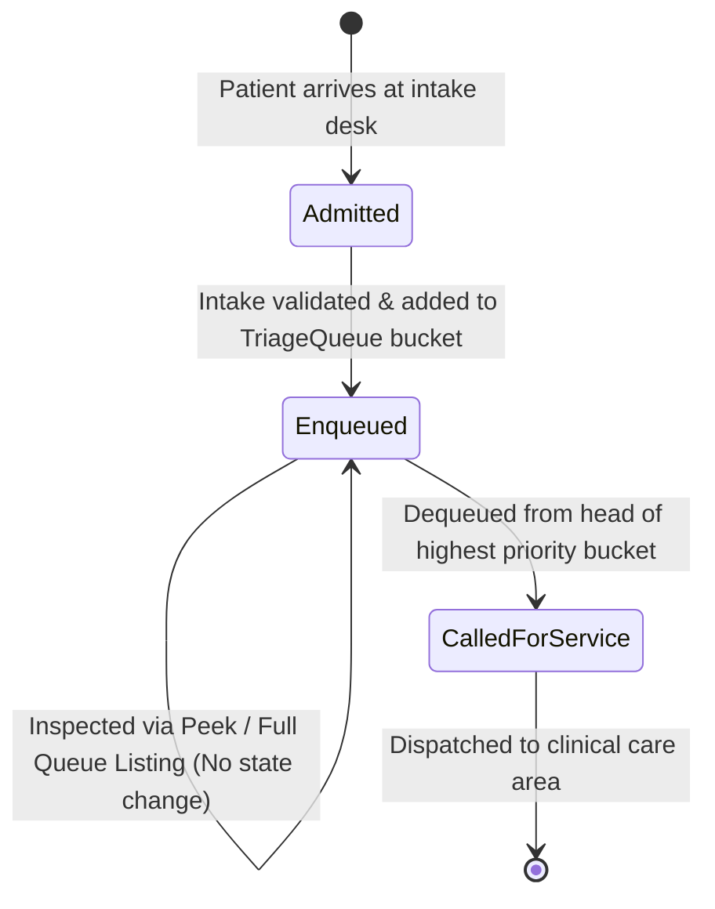

# Data Model: Emergency Unit Triage Queue Manager

**Feature**: Emergency Unit Triage Queue Manager  
**Branch**: `001-triage-queue-manager`  
**Status**: Completed  

---

## 1. Domain Entities & Enums

### 1.1 `TriageLevel` (Enumeration)

Represents the standardized clinical severity scale utilized across the emergency department.

```python
from enum import IntEnum

class TriageLevel(IntEnum):
    CRITICAL = 1
    URGENT = 2
    STANDARD = 3
```

- **Values & Semantics**:
  - `1`: **Critical** (Immediate resuscitation / life-threatening conditions). Highest priority.
  - `2`: **Urgent** (Serious illness / severe pain, rapid attention required). Second priority.
  - `3`: **Standard** (Non-urgent / stable conditions). Third priority.
- **Ordering**:
  - `TriageLevel.CRITICAL < TriageLevel.URGENT < TriageLevel.STANDARD`
  - Priority retrieval evaluates lowest numeric value first.
- **Validation Rules**:
  - Must strictly resolve to integer values `1`, `2`, or `3`.
  - Non-integer strings or numeric values outside `{1, 2, 3}` raise `InvalidTriageLevelError`.

---

### 1.2 `PatientRecord` (Domain Entity)

Represents an individual patient admitted to the emergency triage queue.

```python
from dataclasses import dataclass
from datetime import datetime

@dataclass(frozen=True)
class PatientRecord:
    id: str
    name: str
    triage_level: TriageLevel
    arrived_at: datetime
```

- **Attributes**:
  - `id`: Non-empty unique string identifier (e.g. UUIDv4 string or unique admission reference `PT-XXXX`).
  - `name`: Non-empty string identifying the patient.
  - `triage_level`: Instance of `TriageLevel` (`CRITICAL`, `URGENT`, or `STANDARD`).
  - `arrived_at`: Timezone-aware `datetime` recording the exact admission timestamp.
- **Validation Rules**:
  - `name`: Cannot be empty, whitespace-only, or non-string. Leading and trailing whitespace is stripped upon creation. Length must be $\ge 1$ character.
  - `triage_level`: Must be a valid `TriageLevel` enum member.
  - `arrived_at`: Must be a valid `datetime` object.
  - Immutability: `@dataclass(frozen=True)` prevents any field modification after creation. Attempting to modify attributes raises `FrozenInstanceError`.

---

### 1.3 `QueueStatistics` (Value Object)

Summary snapshot of current departmental triage workload.

```python
@dataclass(frozen=True)
class QueueStatistics:
    critical_count: int
    urgent_count: int
    standard_count: int
    total_count: int
```

- **Invariants**:
  - `critical_count >= 0`
  - `urgent_count >= 0`
  - `standard_count >= 0`
  - `total_count == critical_count + urgent_count + standard_count`

---

## 2. Queue Aggregate & In-Memory State Model

### `TriageQueue` (Aggregate Root)

The central domain model maintaining patient records in strict priority and arrival order.

- **Internal State**:
  - `_buckets: dict[TriageLevel, collections.deque[PatientRecord]]`
    - Mapping each `TriageLevel` (`1`, `2`, `3`) to a dedicated `collections.deque`.
  - `_entry_count: int`: Running counter of total admissions processed during the session.

- **Operations & Behavior**:
  - `enqueue(patient: PatientRecord) -> None`:
    - Validates patient record.
    - Appends patient to the tail of `_buckets[patient.triage_level]`.
    - Increments `_entry_count`.
  - `dequeue() -> Optional[PatientRecord]`:
    - Checks buckets in priority order (`CRITICAL`, `URGENT`, `STANDARD`).
    - Removes and returns the head item from the first non-empty bucket.
    - If all buckets are empty, returns `None` (no exception raised).
  - `peek() -> Optional[PatientRecord]`:
    - Checks buckets in priority order.
    - Returns a reference to the head item of the first non-empty bucket without mutating state.
    - If all buckets are empty, returns `None`.
  - `list_all() -> tuple[PatientRecord, ...]`:
    - Returns an immutable tuple of all active patients sequentially ordered by dispatch sequence:
      `tuple(_buckets[CRITICAL]) + tuple(_buckets[URGENT]) + tuple(_buckets[STANDARD])`.
    - Mutating the returned tuple does not affect internal queue state.
  - `get_statistics() -> QueueStatistics`:
    - Calculates active lengths of each bucket and returns an immutable `QueueStatistics` object.
  - `is_empty() -> bool`:
    - Returns `True` if `total_count == 0`, else `False`.
  - `__len__() -> int`:
    - Returns total active waiting count.

---

## 3. Patient Lifecycle & State Transitions



| Current State | Event / Trigger | Preconditions | Target State | Queue Effect |
|---|---|---|---|---|
| Non-existent | Register Intake | Valid patient name & valid triage level | `Enqueued` | Appended to designated triage level deque tail |
| `Enqueued` | Peek | Queue is not empty | `Enqueued` | None (read-only inspection of head patient) |
| `Enqueued` | List Queue | Any queue state | `Enqueued` | None (read-only traversal of all buckets) |
| `Enqueued` | Call Next Patient | Queue is not empty | `CalledForService` | Removed from head of highest-priority non-empty bucket |
| Empty Queue | Call / Peek Next | Queue has 0 patients | Empty Queue | Returns `None`; user informed with zero errors |
