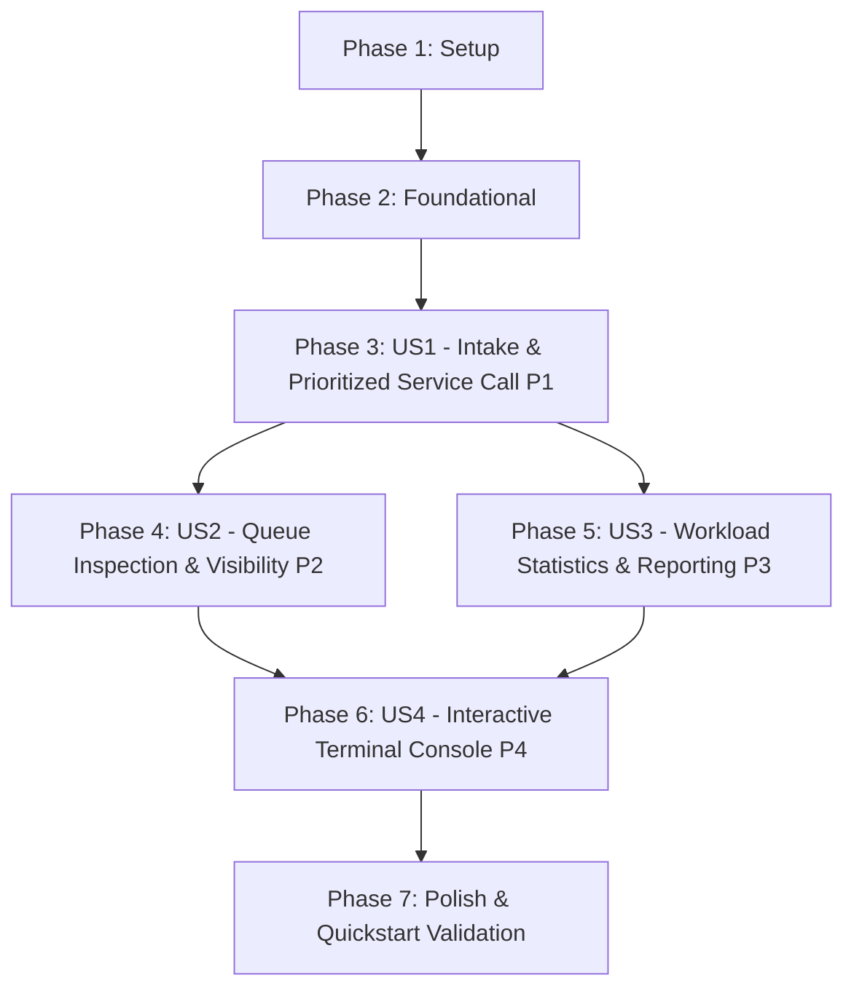

# Tasks: Emergency Unit Triage Queue Manager

**Input**: Design documents from `/specs/001-triage-queue-manager/`  
**Prerequisites**: [plan.md](file:///j:/GitHub/triage-queue/specs/001-triage-queue-manager/plan.md), [spec.md](file:///j:/GitHub/triage-queue/specs/001-triage-queue-manager/spec.md), [research.md](file:///j:/GitHub/triage-queue/specs/001-triage-queue-manager/research.md), [data-model.md](file:///j:/GitHub/triage-queue/specs/001-triage-queue-manager/data-model.md), [contracts/queue-api.md](file:///j:/GitHub/triage-queue/specs/001-triage-queue-manager/contracts/queue-api.md), [contracts/cli-contract.md](file:///j:/GitHub/triage-queue/specs/001-triage-queue-manager/contracts/cli-contract.md), [quickstart.md](file:///j:/GitHub/triage-queue/specs/001-triage-queue-manager/quickstart.md)  
**Tests**: Automated tests using pytest are included per project constitution Principle III (Test-First / TDD).  
**Organization**: Tasks are grouped by user story to enable independent implementation and testing of each story.

## Format: `- [ ] [TaskID] [P?] [Story?] Description with file path`

- **[P]**: Can run in parallel (different files, no dependencies on incomplete tasks)
- **[Story]**: Which user story this task belongs to (e.g., [US1], [US2], [US3], [US4])
- Include exact file paths in descriptions

---

## Phase 1: Setup (Shared Infrastructure)

**Purpose**: Project initialization, environment configuration, and directory layout

- [X] T001 Initialize Python project configuration and pytest runner in pyproject.toml
- [X] T002 [P] Create source and test package directory structure per implementation plan in src/triage_queue/ and tests/

---

## Phase 2: Foundational (Blocking Prerequisites)

**Purpose**: Core infrastructure, domain exceptions, and shared test fixtures that MUST be complete before ANY user story can be implemented

**⚠️ CRITICAL**: No user story work can begin until this phase is complete

- [X] T003 Implement domain error hierarchy in src/triage_queue/exceptions.py
- [X] T004 [P] Implement shared pytest fixtures and test data generators in tests/conftest.py

**Checkpoint**: Foundation ready - domain exceptions and test harness in place. User story implementation can now begin.

---

## Phase 3: User Story 1 - Patient Intake and Prioritized Service Call (Priority: P1) 🎯 MVP

**Goal**: Record newly arrived patients with triage severity (Level 1 Critical, Level 2 Urgent, Level 3 Standard) and retrieve the highest-priority patient next, strictly preserving FIFO order within each priority tier and gracefully returning None on an empty queue.

**Independent Test**: Register patients across diverse triage tiers in non-sequential order (e.g., Standard, Urgent, Critical), verify sequential dequeue calls return Critical first, Urgent second, Standard last. Verify multiple patients at the same triage level dequeue in arrival FIFO order. Verify calling next patient on an empty queue returns `None` without errors.

### Tests for User Story 1 (TDD - Write First) ⚠️

> **NOTE: Write these tests FIRST, ensure they FAIL before implementation**

- [X] T005 [P] [US1] Unit tests for TriageLevel and PatientRecord validation in tests/unit/test_models.py
- [X] T006 [P] [US1] Unit tests for TriageQueue enqueue, dequeue, FIFO ordering, and empty queue handling in tests/unit/test_queue.py
- [X] T007 [P] [US1] Contract test for TriageQueue enqueue and dequeue API contract in tests/contract/test_queue_api.py

### Implementation for User Story 1

- [X] T008 [P] [US1] Implement TriageLevel IntEnum and PatientRecord frozen dataclass with validation factory in src/triage_queue/models.py
- [X] T009 [US1] Implement TriageQueue multi-bucket priority storage, enqueue, and dequeue methods in src/triage_queue/queue.py
- [X] T010 [US1] Export public library symbols in src/triage_queue/__init__.py
- [X] T011 [US1] Integration test for complete patient admission and priority service dispatch lifecycle in tests/integration/test_triage_flow.py

**Checkpoint**: User Story 1 is fully functional and independently verified. Core triage priority scheduling MVP is delivered.

---

## Phase 4: User Story 2 - Queue Inspection and Queue Visibility (Priority: P2)

**Goal**: Inspect the next patient due for service without removing them (peek), and view the full waiting queue in exact dispatch sequence without mutating or reordering queue state.

**Independent Test**: Add multiple patients across various triage tiers, call `peek()` and assert that the head patient details are returned while queue length and order remain identical. Call `list_all()` and verify that the full sequential tuple accurately reflects priority tiers and FIFO ordering without mutating queue state. Verify `peek()` on empty queue returns `None`.

### Tests for User Story 2 (TDD - Write First) ⚠️

- [X] T012 [P] [US2] Unit tests for TriageQueue peek() and list_all() non-mutating queue inspection in tests/unit/test_queue.py
- [X] T013 [P] [US2] Contract tests for peek() and list_all() API specifications in tests/contract/test_queue_api.py

### Implementation for User Story 2

- [X] T014 [US2] Implement peek() and list_all() methods on TriageQueue in src/triage_queue/queue.py
- [X] T015 [US2] Integration test verifying peek and queue listing preserve queue immutability under inspection in tests/integration/test_triage_flow.py

**Checkpoint**: User Stories 1 and 2 are fully functional and independently verifiable. Staff have complete queue visibility.

---

## Phase 5: User Story 3 - Triage Workload Statistics and Reporting (Priority: P3)

**Goal**: Calculate and report aggregate summary counts of waiting patients categorized by triage level (Critical, Urgent, Standard) and total count in O(1) time.

**Independent Test**: Enqueue known distributions of patients across Levels 1, 2, and 3, call `get_statistics()`, and assert that counts per tier and overall totals match exact waiting counts. Verify calling dequeue immediately decrements the respective tier count and total count. Verify empty queue displays zero counts across all tiers without errors.

### Tests for User Story 3 (TDD - Write First) ⚠️

- [X] T016 [P] [US3] Unit tests for QueueStatistics value object invariants and get_statistics() accuracy in tests/unit/test_queue.py
- [X] T017 [P] [US3] Contract tests for QueueStatistics schema and get_statistics() in tests/contract/test_queue_api.py

### Implementation for User Story 3

- [X] T018 [P] [US3] Implement QueueStatistics frozen dataclass with invariants in src/triage_queue/models.py
- [X] T019 [US3] Implement get_statistics() calculation method in src/triage_queue/queue.py
- [X] T020 [US3] Integration test verifying real-time statistics updates across enqueue, peek, and dequeue cycles in tests/integration/test_triage_flow.py

**Checkpoint**: User Stories 1, 2, and 3 are complete. Core scheduling library provides full scheduling, visibility, and analytics.

---

## Phase 6: User Story 4 - Interactive Terminal Console Interface (Priority: P4)

**Goal**: Provide an interactive, resilient terminal menu interface offering intake, dequeue, peek, queue listing, statistics display, and exit, with robust input validation loops that gracefully recover from invalid inputs or empty queue states without crashing.

**Independent Test**: Run console menu loop against simulated stdin inputs: enter blank names and invalid triage levels to verify validation prompts reprompt cleanly; execute intake, dequeue, peek, list queue, and statistics options; verify empty queue operations output clear informative notices; select option 6 to verify clean process termination.

### Tests for User Story 4 (TDD - Write First) ⚠️

- [X] T021 [P] [US4] Contract tests for CLI menu commands, table formatting, and input validation loops with mocked IO in tests/contract/test_cli_contract.py

### Implementation for User Story 4

- [X] T022 [P] [US4] Implement terminal formatting helpers and tabular queue/statistics display in src/triage_queue/cli/console.py
- [X] T023 [US4] Implement interactive menu loop and resilient input dialogs with validation error recovery in src/triage_queue/cli/menu.py
- [X] T024 [P] [US4] Implement CLI package exports and module entry point in src/triage_queue/cli/__init__.py and src/triage_queue/cli/__main__.py
- [X] T025 [P] [US4] Implement standalone script entry point in src/triage_queue/cli/main.py
- [X] T026 [US4] Integration test verifying full terminal session end-to-end workflow from launch to exit in tests/integration/test_triage_flow.py

**Checkpoint**: User Story 4 complete. Full interactive terminal triage manager is fully operational.

---

## Phase 7: Polish & Cross-Cutting Concerns

**Purpose**: End-to-end verification, documentation, and quality gates across all user stories

- [X] T027 [P] Validate all end-to-end quickstart scenarios from specs/001-triage-queue-manager/quickstart.md
- [X] T028 Run full test suite with coverage and verify zero regressions via pytest in pyproject.toml
- [X] T029 [P] Update project documentation and usage instructions in README.md

---

## Dependencies & Execution Order

### Phase Dependencies

- **Setup (Phase 1)**: No dependencies - can start immediately.
- **Foundational (Phase 2)**: Depends on Phase 1 completion - BLOCKS all user stories.
- **User Stories (Phases 3-6)**: All depend on Foundational (Phase 2) completion.
  - User Story 1 (P1): Core domain logic (models, multi-bucket deque, enqueue, dequeue).
  - User Story 2 (P2): Depends on US1 domain models and queue aggregate (adds peek and list_all).
  - User Story 3 (P3): Depends on US1 domain models and queue aggregate (adds QueueStatistics and get_statistics).
  - User Story 4 (P4): Depends on US1, US2, and US3 library methods to provide complete CLI functionality.
- **Polish (Phase 7)**: Depends on all user stories (Phases 3-6) being complete.

### User Story Dependencies



### Within Each User Story

1. Tests written and confirmed failing before implementation code (TDD).
2. Domain models / value objects before aggregate methods.
3. Queue aggregate methods before presentation/CLI integration.
4. End-to-end integration test validating story acceptance scenarios before moving to next priority.

---

## Parallel Opportunities

- **Phase 1 (Setup)**: T002 can run in parallel with T001.
- **Phase 2 (Foundational)**: T004 can run in parallel with T003.
- **Phase 3 (User Story 1)**:
  - Tests T005, T006, and T007 can be written in parallel.
  - Model implementation T008 can proceed in parallel with test authoring.
- **Phase 4 (User Story 2) & Phase 5 (User Story 3)**:
  - Once US1 is complete, US2 (Queue Visibility) and US3 (Queue Statistics) can proceed completely in parallel as they touch orthogonal methods on `TriageQueue`.
  - Tests T012, T013, T016, and T017 can be written in parallel.
- **Phase 6 (User Story 4)**:
  - T021 (Contract tests), T022 (Console formatting), T024 (CLI module entry points), and T025 (CLI standalone main) can be authored in parallel.
- **Phase 7 (Polish)**:
  - T027 (Quickstart validation) and T029 (README documentation) can run in parallel.

---

## Parallel Example: User Story 1

```bash
# Launch test authoring in parallel:
Task: "Unit tests for TriageLevel and PatientRecord validation in tests/unit/test_models.py" (T005)
Task: "Unit tests for TriageQueue enqueue, dequeue, FIFO ordering in tests/unit/test_queue.py" (T006)
Task: "Contract test for TriageQueue enqueue and dequeue API contract in tests/contract/test_queue_api.py" (T007)

# Launch model implementation in parallel:
Task: "Implement TriageLevel IntEnum and PatientRecord frozen dataclass in src/triage_queue/models.py" (T008)
```

---

## Implementation Strategy

### MVP First (User Story 1 Only)

1. Complete Phase 1: Setup (`pyproject.toml`, directory structure).
2. Complete Phase 2: Foundational (exceptions, test fixtures).
3. Complete Phase 3: User Story 1 (models, multi-bucket deque, enqueue, dequeue).
4. **STOP and VALIDATE**: Run `pytest tests/unit/test_models.py tests/unit/test_queue.py tests/contract/test_queue_api.py tests/integration/test_triage_flow.py` to confirm the core priority scheduling engine works flawlessly.

### Incremental Delivery

1. Setup + Foundation complete $\rightarrow$ Base test and exception framework ready.
2. User Story 1 $\rightarrow$ Priority intake and dispatch functioning (**MVP**).
3. User Story 2 $\rightarrow$ Peek and full queue visibility added.
4. User Story 3 $\rightarrow$ Workload statistics and tier counts added.
5. User Story 4 $\rightarrow$ Resilient interactive terminal console interface added.
6. Polish $\rightarrow$ Quickstart scenario validation, test suite coverage, and documentation complete.

---

## Notes

- All tasks strictly adhere to the checklist format: `- [ ] [TaskID] [P?] [Story?] Description with file path`.
- Setup and Foundational tasks have no story tag; User Story tasks have `[US1]`, `[US2]`, `[US3]`, or `[US4]`; Polish tasks have no story tag.
- Every task includes an explicit, unambiguous file path.
- Verify tests fail before implementing code (TDD cycle).
